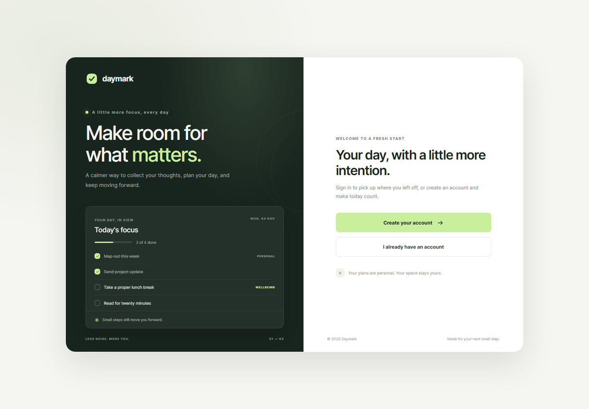

# Daymark

Daymark is a full-stack task planner designed to make it easier to focus on the next small step. Create an account, sign in, and manage a personal task list that stays private to your account.

## App preview



The welcome screen includes a preview of the task dashboard. The authenticated dashboard supports adding, completing, and deleting tasks.

## What I built

- A responsive React interface with welcome, sign-up, sign-in, and task dashboard screens.
- Account creation and login with password hashing, server-managed sessions, and a persistent MongoDB session store.
- Authenticated task creation, listing, completion, and deletion, scoped to the signed-in user.
- Request validation and origin checks in the API, plus clear loading and error states in the client.
- A production-ready frontend build generated by Vite.

## Technology

| Area | Libraries and tools |
| --- | --- |
| Frontend | React 19, React DOM, JavaScript, CSS |
| Frontend tooling | Vite 8, `@vitejs/plugin-react`, ESLint |
| Backend | Node.js, Express 5 |
| Database | MongoDB, Mongoose 8 |
| Authentication | `express-session`, `connect-mongo`, `bcryptjs` |
| API and configuration | `cors`, `dotenv`, Vite development proxy |

## Run locally

Requirements: Node.js and npm, plus a MongoDB database.

1. Clone the repository and install the API dependencies:

   ```powershell
   git clone https://github.com/UmairImtiazK/daymark.git
   cd daymark
   cd server
   npm install
   Copy-Item .env.example .env
   ```

2. Edit `server/.env`. Set `MONGODB_URI` to your own MongoDB connection string and set `SESSION_SECRET` to a random secret of at least 32 characters. For example, generate a secret in PowerShell:

   ```powershell
   node -e "console.log(require('crypto').randomBytes(32).toString('hex'))"
   ```

   Keep your connection string and secret private. `server/.env` is ignored by Git.

3. Start the API from the `server` directory:

   ```powershell
   npm run dev
   ```

4. In a second terminal, from the project root, install the frontend dependencies and start Vite:

   ```powershell
   npm install
   npm run dev
   ```

   Open the URL printed by Vite (usually `http://localhost:5173`). In development, Vite forwards `/api` requests to `http://localhost:5000`.

The API uses `PORT` (default `5000`) and `CLIENT_URL` (default `http://localhost:5173`) from `server/.env`. See [`server/.env.example`](server/.env.example) for the available settings.

## Production build

From the project root, build the frontend:

```powershell
npm run build
```

Vite writes the optimized static site to `dist/`. To test that build locally:

```powershell
npm run preview
```

Deploy `dist/` to a static hosting provider and run the Express API as a Node.js service connected to MongoDB. Configure `CLIENT_URL` to the frontend origin, set `NODE_ENV=production`, and provide a secure `SESSION_SECRET` and `MONGODB_URI`. Set `VITE_API_URL` before building if the API is hosted at a different origin. Serve production traffic over HTTPS so the secure session cookie works.

Useful project commands:

```powershell
npm run lint
npm run build
```

## Authentication and data flow

- The frontend calls `/api/auth/signup`, `/api/auth/login`, and `/api/auth/me` for account and session operations; `/api/auth/logout` ends a session.
- Passwords are hashed with `bcryptjs` before storage; the original password is not stored.
- The API stores sessions in MongoDB through `connect-mongo` and uses an HttpOnly cookie.
- Task API routes require a valid session. Each task has a `userId`, and task reads, updates, and deletes are scoped to that user.
- Task fields include `title`, `description`, `dueDate`, and `completed`. Existing tasks without an owner are not shown in an account's private list.

## API endpoints

### Authentication

- `POST /api/auth/signup` — `{ "name": "Alex Morgan", "email": "alex@example.com", "password": "at-least-8-characters" }`
- `POST /api/auth/login` — `{ "email": "alex@example.com", "password": "your-password" }`
- `GET /api/auth/me` — return the signed-in user
- `POST /api/auth/logout` — end the current session

### Tasks (sign-in required)

- `GET /api/tasks` — list the signed-in user's tasks
- `POST /api/tasks` — create a task, for example `{ "title": "Plan the day" }`
- `PATCH /api/tasks/:id` — update task fields
- `DELETE /api/tasks/:id` — delete a task

## Project structure

```text
src/
  components/       Authenticated task dashboard
  lib/              Shared API request helper
  App.jsx           Welcome, account, and session flow
  App.css           Authentication and welcome styles
  dashboard.css     Task dashboard styles
server/
  src/
    controllers/    Authentication and task request handling
    middleware/     Session authentication and origin checks
    models/         Mongoose User and Task schemas
    routes/         Authentication and task API endpoints
    app.js          Express middleware and route wiring
    server.js       Environment validation and MongoDB startup
docs/screenshots/   App screenshots used in this README
```
